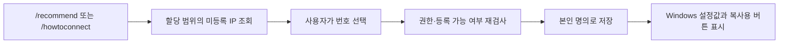
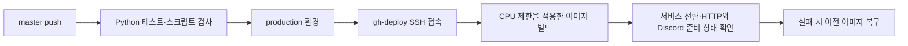

<div align="center">

# IPCHAN

**연구실 IP 등록·추천을 위한 Discord 봇**

[](https://github.com/pcugame-lab/pcugame-ipchan/actions/workflows/deploy.yml)
[](https://www.python.org/)
[](https://discordpy.readthedocs.io/)
[](docker-compose.yml)

IP 현황 조회부터 번호 선택, 본인 명의 등록, Windows 연결 안내까지.

[빠른 시작](#빠른-시작) · [명령어](#명령어) · [IP 추천과 등록](#ip-추천과-등록) · [환경변수](#환경변수) · [개발과 검증](#개발과-검증) · [자동 배포](#자동-배포)

</div>

---

## 주요 기능

| 기능 | 동작 |
| --- | --- |
| IP 현황 | IP·이름·기기/등록일을 각 줄의 코드 박스로 표시하고 페이지 이동 지원 |
| 모바일 보기 | 결과의 버튼으로 전환하며 IP는 마지막 옥텟만 표시 |
| IP 추천 | 지정 범위에서 등록부에 없는 번호를 제안하고 선택 즉시 본인 명의로 저장 |
| 범위 밖 확인 | 할당 범위 밖의 주소는 확인 후 처리하며, 다른 서브넷의 주소는 거부 |
| Windows 연결 안내 | 한국어 설정 항목명, IPv4 입력값, 항목별 복사용 버튼 제공 |
| 현재 IP 감지 | 일회용 링크를 통한 브라우저 확인과 IP 등록 |
| 관리자 기능 | 다른 사용자의 IP 해제와 등록 정보 수정 지원 |

## 빠른 시작

### Discord 애플리케이션

1. [Discord Developer Portal](https://discord.com/developers/applications)에서 애플리케이션과 봇을 생성한다.
2. **Bot → Reset Token**에서 발급한 토큰을 `.env`의 `DISCORD_TOKEN`에 지정한다.
3. OAuth2 초대 링크에 `bot`, `applications.commands` scope와 `Send Messages`, `Embed Links` 권한을 지정한다.
4. Discord의 개발자 모드를 활성화하고 서버·채널·역할 ID를 복사한다. Message Content Intent는 필요하지 않다.

### Docker Compose 실행

```bash
git clone https://github.com/pcugame-lab/pcugame-ipchan.git
cd pcugame-ipchan
cp .env.example .env
```

`.env`에서 토큰과 서버 ID를 입력하고, 사용할 네트워크에 맞게 다음 값을 지정한다.

```dotenv
DISCORD_TOKEN=your_bot_token_here
GUILD_1_ID=your_guild_id_here
GUILD_1_CHANNEL_ID=your_channel_id_here
GUILD_1_ROLE_ID=your_role_id_here

IP_PREFIX=192.168.1
IP_LAST_OCTET_RANGE=100-199

WEB_HOST=0.0.0.0
WEB_PORT=8080
WEB_BASE_URL=http://192.168.1.10:8080
```

`WEB_BASE_URL`에는 **봇 웹서버에 실제로 접근할 수 있는 주소**를 지정한다. 위 주소는 예시이며, 자신의 서버 주소로 변경한다.

```bash
docker compose up -d --build
docker compose logs -f labip-bot
```

시작 시 설정한 서버에 슬래시 명령어가 동기화된다. 데이터와 로그는 Compose의 named volume에 저장된다.

## 명령어

| 명령어 | 용도 | 예시 |
| --- | --- | --- |
| `/status` | 전체 IP 현황, 페이지 이동, 모바일 보기 | `/status` |
| `/recommend` | 미등록 IP 추천과 선택 등록 | `/recommend` |
| `/howtoconnect [ip]` | Windows 유선 인터넷 설정 안내 | `/howtoconnect ip:100` |
| `/register [ip] [device] [person]` | 직접 등록 또는 자동 감지 링크 발급 | `/register ip:100 device:노트북 person:홍길동` |
| `/change <ip> [device] [person]` | 등록된 기기·이름 수정 | `/change ip:100 device:데스크탑` |
| `/release <ip 또는 이름>` | IP 또는 이름으로 등록 해제 | `/release ip:100` |
| `/help` | 명령어 도움말 | `/help` |

IP는 전체 주소와 마지막 옥텟을 모두 지원한다. `IP_PREFIX=192.168.1`이면 `100`은 `192.168.1.100`으로 처리한다. 사람 이름을 생략하면 Discord 표시 이름을 사용한다.

등록·수정·해제·현황·추천·연결 안내에는 서버·채널·역할 조건을 적용한다. 채널 또는 역할 환경변수가 공란이면 해당 제한을 해제한다. `/help`에는 별도 채널·역할 검사가 없다.

### 관리자 권한

`ADMIN_USER_IDS`에 쉼표로 구분한 Discord 사용자 ID를 지정한다. 관리자는 다른 사용자의 등록 정보 수정과 해제가 가능하며, 서버·채널·역할 조건은 동일하게 적용한다.

다른 사용자의 IP를 `/register`로 수정해도 기존 소유자는 유지한다. 이름으로 해제할 때 일반 사용자는 본인 등록만, 관리자는 해당 이름의 전체 등록을 해제한다.

## IP 추천과 등록



- `IP_LAST_OCTET_RANGE=100-199`는 양 끝을 포함한다. 범위는 `1~254` 내에서 지정하며 게이트웨이 끝자리 `1`은 추천에서 제외한다.
- 추천은 **등록 데이터 기준**이다. 실제 네트워크의 사용 여부를 검사하지 않는다.
- 다른 사용자가 먼저 등록한 번호는 선택 시 거부하고 남은 번호를 다시 표시한다.
- 번호 선택 시 Discord 표시 이름으로 등록한다. 기기와 이름은 이후 `/change`로 수정할 수 있다.
- 범위가 공란이면 `마지막 옥텟 정보가 입력되어 있지 않아서 추천은 불가능하다`를 표시한다.

### 범위 밖 주소

동일 서브넷이지만 지정한 끝자리 범위 밖의 IP를 입력하면 다음 질문을 표시한다.

> 할당된 IP 범위 밖입니다... 진짜 괜찮아요?

수동 등록과 연결 안내에서는 본인이 **네, 계속할게요**를 선택해야 처리한다. 자동 감지 등록에서는 브라우저의 추가 확인을 거친다. 취소하거나 확인하지 않으면 등록하지 않는다. 범위가 공란이면 이 확인 절차를 적용하지 않는다.

### Windows 설정값

`/howtoconnect`는 **설정 → 네트워크 및 인터넷 → 이더넷 → IP 할당 → 편집** 경로와 기존 IPv4 속성 창 경로를 안내한다. 본인 등록 IP가 하나면 자동으로 표시하며, 여러 개면 `ip`로 지정할 수 있다. 안내 조회와 `ip` 지정만으로는 등록되지 않는다.

| 설정 항목 | 표시값 |
| --- | --- |
| IP 주소 | 선택한 전체 IP 주소 |
| 서브넷 마스크 | `255.255.255.0` |
| 서브넷 접두사 길이 | `24` |
| 게이트웨이 | `IP_PREFIX.1` |
| 기본 설정 DNS | `8.8.8.8` |

항목 버튼은 값 하나를 복사용 코드 박스로 표시한다. Discord 버튼으로 클립보드에 직접 기록하지는 않는다. Windows 설정은 사용자가 직접 입력한다.

## 환경변수

전체 예시는 [`.env.example`](.env.example)을 참조한다.

| 변수 | 기본값 / 형식 | 용도 |
| --- | --- | --- |
| `DISCORD_TOKEN` | 필수 | 봇 토큰 |
| `GUILD_N_ID` | 최소 `GUILD_1_ID` 필수 | 사용할 서버 ID, 번호를 연속으로 지정 |
| `GUILD_N_CHANNEL_ID` | 공란 허용 | 명령어 허용 채널 |
| `GUILD_N_ROLE_ID` | 공란 허용 | 명령어 허용 역할 |
| `IP_PREFIX` | 필수 | 등록 허용 서브넷의 앞 3옥텟 |
| `IP_LAST_OCTET_RANGE` | 공란 / `시작-끝` | IP 추천과 범위 밖 확인 기준 |
| `ADMIN_USER_IDS` | 공란 / 쉼표 구분 ID | 관리자 목록 |
| `WEB_HOST` | `127.0.0.1` | 웹서버 bind 주소 |
| `WEB_PORT` | `8080` | 웹서버 포트 |
| `WEB_BASE_URL` | `http://localhost:8080` | 사용자에게 전달할 등록 링크의 기본 주소 |
| `TOKEN_TTL_SECONDS` | `300` | 자동 등록 토큰 유효 시간, 초 |
| `RATE_LIMIT_WINDOW` | `60` | 자동 등록 요청 제한 시간, 초 |
| `RATE_LIMIT_MAX` | `10` | 시간 내 IP별 최대 POST 요청 수 |
| `IP_STATE_FILE` | `data/ip-state.json` | 등록 데이터 경로 |
| `TOKEN_FILE` | `data/ip-tokens.json` | 일회용 토큰 저장 경로 |
| `TZ` | `.env.example`: `Asia/Seoul` | 컨테이너 시간대 |

Docker Compose에서 환경변수를 변경한 뒤에는 `docker compose up -d --force-recreate`로 컨테이너를 재생성한다. `.env`, 데이터 파일, 토큰 파일은 Git에 포함하지 않는다.

## 자동 감지 등록

1. `/register`에서 `ip`를 생략하여 일회용 링크를 발급한다.
2. 사용자가 링크를 열면 브라우저에 등록 확인 폼을 표시한다. GET 요청은 데이터를 변경하거나 토큰을 소비하지 않는다.
3. **등록하기**를 누르면 POST 요청에서 접속 IP와 토큰을 검사한다.
4. 할당 범위 밖이면 추가 확인 폼을 표시한다. 확인 토큰은 처음 감지한 IP에만 유효하며 한 번만 사용할 수 있다.
5. 등록 결과를 표시한다. 이미 다른 사람에게 등록된 IP는 덮어쓰지 않는다.

접속 IP는 직접 연결의 주소를 사용한다. `X-Real-IP`, `X-Forwarded-For`는 신뢰하지 않으므로, IP를 전달하는 reverse proxy 뒤에 배치하면 자동 감지가 정상 동작하지 않을 수 있다. 단일 봇 프로세스가 등록 저장소를 관리하는 구성을 전제로 한다.

## 개발과 검증

Python 3.12 환경에서 실행한다. `.env`는 애플리케이션 시작 시 자동으로 읽는다.

```bash
python3 -m venv .venv
source .venv/bin/activate
pip install -r requirements.txt
python -m app.main
```

테스트는 임시 저장소와 모의 Discord 요청을 사용한다.

```bash
python -m unittest discover -s tests -v
```

| 경로 | 역할 |
| --- | --- |
| [`app/bot.py`](app/bot.py) | 슬래시 명령어와 권한 처리 |
| [`app/formatter.py`](app/formatter.py) | 현황 출력과 모바일 전환 |
| [`app/connect.py`](app/connect.py) | Windows 연결 안내와 복사용 버튼 |
| [`app/recommend.py`](app/recommend.py) | 미등록 IP 조회와 선택 등록 |
| [`app/range_confirmation.py`](app/range_confirmation.py) | 범위 밖 확인 |
| [`app/webserver.py`](app/webserver.py) | 자동 등록 웹 요청 |
| [`tests/`](tests/) | 관리자 권한·출력·추천·확인·웹 등록 회귀 검사 |

## 자동 배포

[`Test and deploy`](.github/workflows/deploy.yml)는 `pcugame-lab/pcugame-ipchan`의 `master` 변경을 대상으로 한다. Pull request에서는 테스트만 수행한다.



### GitHub 설정

`production` 환경의 배포 허용 브랜치는 `master`로 제한한다. 다음 값을 설정한다.

| 구분 | 이름 | 용도 |
| --- | --- | --- |
| Repository variable | `IPCHAN_DEPLOY_ENABLED` | 서버 준비와 최초 이전을 완료한 후 `true`로 지정 |
| Environment secret | `IPCHAN_DEPLOY_SSH_KEY` | 전용 배포 SSH 개인키 |
| Environment variable | `IPCHAN_SSH_HOST` | GitHub runner에서 접근 가능한 서버 주소 |
| Environment variable | `IPCHAN_SSH_PORT` | SSH 포트, 공란이면 `5050` |
| Environment variable | `IPCHAN_SSH_KNOWN_HOSTS` | 서버에서 확인한 SSH host key와 주소·포트 |

자동 배포는 해당 저장소의 `master`에서만 실행한다. 최신 커밋으로 대체된 배포는 활성화를 생략하며, 배포 작업은 순서대로 실행한다. **Actions → Test and deploy → Run workflow**에서도 현재 `master`를 배포할 수 있다.

### 서버 구성

서버에는 `gh-deploy` 계정의 SSH 접속, rootless Podman, user systemd, lingering이 필요하다. [`deploy/bootstrap.sh`](deploy/bootstrap.sh)는 해당 계정으로 실행하여 전용 경로를 초기화한다.

| 경로 / 서비스 | 용도 |
| --- | --- |
| `~/server/ipchan/shared/.env` | 서버에만 저장하는 봇 환경변수 |
| `~/server/ipchan/shared/data/` | 등록 데이터와 일회용 토큰 |
| `~/server/ipchan/shared/logs/` | 애플리케이션 로그 |
| `~/server/ipchan/releases/<SHA>/` | 커밋별 소스 |
| `~/server/ipchan/current` | 마지막 정상 배포 소스 |
| `~/server/ipchan/backups/` | 배포 전 서비스 설정과 데이터 복사본 |
| `pcugame-ipchan.service` | `gh-deploy`의 user systemd 서비스 |

기존 봇을 이전할 때는 기존 서비스를 중지하고 `.env`, `data/`, `logs/`를 `shared/`에 복사한 뒤 새 서비스를 시작한다. 동일 토큰의 봇 두 개를 동시에 실행하지 않는다. 초기 이전이 실패하면 기존 서비스를 복구한다.

[`deploy/rootless-deploy.sh`](deploy/rootless-deploy.sh)는 빌드에 전체 논리 CPU 시간의 90% 한도와 낮은 CPU·I/O 우선순위를 적용한다. HTTP `/health`와 Discord의 준비 완료 로그를 모두 확인한 후 배포 성공으로 기록한다. 실패 시 이전 서비스 설정과 이미지를 복구하며, 등록 데이터는 이전 상태로 되돌리지 않는다.

운영 명령은 `gh-deploy` 계정에서 실행한다.

```bash
systemctl --user status pcugame-ipchan.service
journalctl --user -u pcugame-ipchan.service -n 100 --no-pager
cat ~/server/ipchan/deployed-revision
```

## 운영 점검

| 증상 | 확인 사항 |
| --- | --- |
| 명령어가 표시되지 않음 | 초대 scope의 `applications.commands`, 서버 ID, 시작 로그의 동기화 결과 |
| 채널·역할 권한 오류 | `GUILD_N_CHANNEL_ID`, `GUILD_N_ROLE_ID`와 실행 위치·역할 |
| 추천 불가 안내 | `IP_LAST_OCTET_RANGE` 지정 여부와 컨테이너 재생성 여부 |
| 추천할 번호가 없음 | 지정 범위의 등록 현황, 필요 시 기존 등록 해제 |
| 자동 등록 링크 접근 실패 | `WEB_BASE_URL`, bind 주소, 방화벽, 실제 접근 가능한 포트 |
| 허용 대역 오류 | 접속 네트워크와 `IP_PREFIX` 일치 여부, reverse proxy 사용 여부 |
| 버튼 응답 만료 | 명령어를 다시 실행하여 새 버튼 생성 |

```bash
docker compose logs --tail=100 labip-bot
docker compose down
```

일반 중지로 named volume은 유지된다. `docker compose down -v`는 등록 데이터가 포함된 volume을 삭제하므로 주의가 필요하다.
